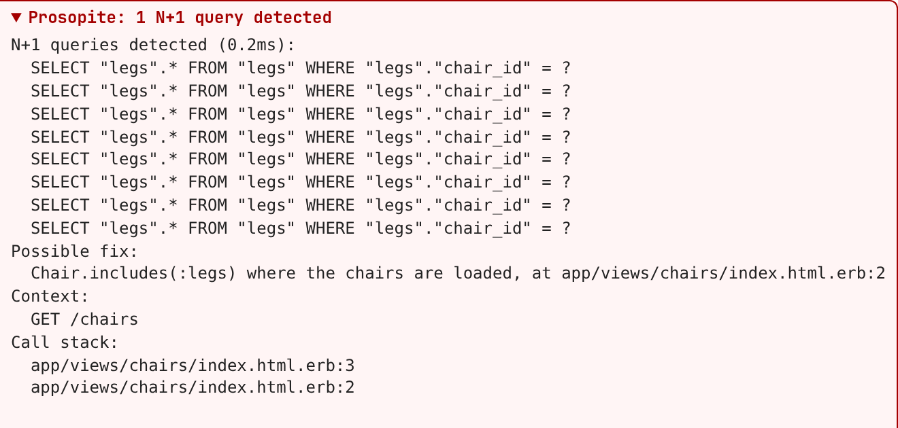

# Prosopite  [](https://badge.fury.io/rb/prosopite)

Prosopite auto-detects N+1 queries in Rails apps, with zero false positives and false negatives. It finds every
query that repeats from the same place in your code, not only the lazy loading of associations, and suggests how
to fix it:

```
N+1 queries detected (1.2ms):
  SELECT "legs".* FROM "legs" WHERE "legs"."chair_id" = $1 ORDER BY "legs"."id" ASC LIMIT $2
  SELECT "legs".* FROM "legs" WHERE "legs"."chair_id" = $1 ORDER BY "legs"."id" ASC LIMIT $2
  SELECT "legs".* FROM "legs" WHERE "legs"."chair_id" = $1 ORDER BY "legs"."id" ASC LIMIT $2
Possible fix:
  Chair.includes(:legs) where the chairs are loaded, at app/views/chairs/index.html.erb:2
Context:
  GET /chairs
Call stack:
  app/views/chairs/index.html.erb:3
  app/views/chairs/index.html.erb:2
```

* [Quick start](#quick-start)
* [How it works](#how-it-works)
* [Usage](#usage): [development](#development), [tests](#tests), [jobs](#jobs), [production](#production),
  [any code](#scanning-any-code)
* [Reports](#reports): [loggers](#loggers), [fix suggestions](#fix-suggestions),
  [structured notifications](#structured-notifications), [CI](#ci)
* [Ignoring N+1 queries](#ignoring-n1-queries)
* [Configuration](#configuration)
* Compared to [Bullet](#compared-to-bullet) and [strict_loading](#compared-to-strict_loading)

## Quick start

Add Prosopite to your Gemfile:

```ruby
gem 'prosopite'
gem 'pg_query' # Optional, with PostgreSQL
```

With PostgreSQL, [pg_query](https://github.com/pganalyze/pg_query) makes the fingerprints of queries more precise,
but it's a native extension that doesn't install everywhere, and Prosopite works without it.

Then install it and set it up:

    $ bundle install
    $ bin/rails generate prosopite:install

The generator creates `config/initializers/prosopite.rb`, which shows N+1 queries on the pages in development and
raises for them in tests, and it scans each test. N+1 queries also go to the Rails log, unless another logger is set.
The sections below show how to set it up yourself.

Prosopite needs Ruby 2.7+ and Rails 6.1+. The footer on pages needs Rails 7.1+, and the scanning of fibers Ruby 3.2+.

## How it works

Prosopite subscribes to the SQL queries of Active Record. In a scan, e.g. of a request, a job or a test, it reports
the queries that run more than once from the same call stack and have the same fingerprint, i.e. that are the same
query apart from its values. Queries on different databases, e.g. on shards, never count together.

## Usage

### Development

The Rack middleware scans every request:

```ruby
# config/initializers/prosopite.rb

if Rails.env.development?
  require 'prosopite/middleware/rack'
  Rails.configuration.middleware.use(Prosopite::Middleware::Rack)
end
```

N+1 queries go to the Rails log, with the method and the path of the request as their context, e.g. `GET /chairs`.
In tests, the scan of each test covers its requests instead, see [Tests](#tests).

To see the N+1 queries of a page on the page itself, in a footer and/or the browser console:

```ruby
# config/environments/development.rb

config.after_initialize do
  Prosopite.add_footer = true
  Prosopite.browser_console = true
end
```



They also get the N+1 queries of later requests, like the ones of Turbo frames and streams or of other fetch and
XHR requests, which send them in an `x-prosopite-notifications` header. Requests that redirect, like form
submissions, can't show theirs, which go to the log only. The footer and the console need Rails 7.1+, show only when
`Prosopite.raise` is off, and follow your Content Security Policy: they use its nonce, if any, and leave out a style
or a script that it would block.

Instead of the middleware, an `around_action` can scan the actions of controllers. Don't use a `before_action` and an
`after_action` for this: an exception skips the `after_action`, leaving the scan open into the next request.

```ruby
class ApplicationController < ActionController::Base
  if Rails.env.development?
    around_action :n_plus_one_detection

    def n_plus_one_detection
      Prosopite.scan
      yield
    ensure
      Prosopite.finish
    end
  end
end
```

### Tests

To make the tests with N+1 queries fail, raise for them and scan each test:

```ruby
# config/environments/test.rb

config.after_initialize do
  Prosopite.raise = true
end
```

```ruby
# spec/rails_helper.rb

RSpec.configure do |config|
  config.before { |example| Prosopite.scan(example.location) unless example.metadata[:prosopite] == false }
  config.after { Prosopite.finish }
end
```

```ruby
# test/test_helper.rb

class ActiveSupport::TestCase
  setup { Prosopite.scan("#{self.class}##{name}") }
  teardown { Prosopite.finish }
end
```

Each test is a scan of its own, with its location or name as the context, and specs can opt out with
`prosopite: false`. Don't scan the whole suite, as that would count the queries of different tests together.

The N+1 queries of [FactoryBot](https://github.com/thoughtbot/factory_bot) factories are usually only test setup.
To leave them out, pause the scans while factories run:

```ruby
# config/environments/test.rb

config.after_initialize do
  Prosopite.pause_during('factory_bot.run_factory')
end
```

#### Assertions

To check specific code for N+1 queries, or to check that it has some, use the RSpec matcher:

```ruby
# spec/rails_helper.rb
require 'prosopite/rspec'

# in a spec
expect { get :index }.not_to have_n_plus_one_queries
```

or the Minitest assertions:

```ruby
# test/test_helper.rb
require 'prosopite/minitest'

# in a test
assert_no_n_plus_one_queries { get chairs_url }
assert_n_plus_one_queries { Chair.all.each { |chair| chair.legs.first } }
```

The block runs in a scan of its own, so its N+1 queries are reported only by the assertion, even when each test
is scanned too. `Prosopite.n_plus_one_queries { ... }` returns them for any other use.

#### Adopting Prosopite gradually

To start using Prosopite on an app that already has N+1 queries, record them in a todo file. Its N+1 queries are
then ignored, while new ones are reported:

```ruby
# config/environments/test.rb

config.after_initialize do
  Prosopite.todo_file = Rails.root.join('.prosopite_todo.yml')
  Prosopite.record_todo = ENV['PROSOPITE_RECORD_TODO'].present?
end
```

    $ PROSOPITE_RECORD_TODO=1 bin/rails test

Entries match by query and file, so remove the ones of the N+1 queries you fix, or delete the file and record it
again. The assertions above don't use the todo file.

### Jobs

The Sidekiq middleware, for Sidekiq 6.5+, scans every job, with its class, ID and queue as context:

```ruby
Sidekiq.configure_server do |config|
  unless Rails.env.production?
    config.server_middleware do |chain|
      require 'prosopite/middleware/sidekiq'
      chain.add(Prosopite::Middleware::Sidekiq)
    end
  end
end
```

Other jobs can be scanned with a callback, e.g. for Active Job:

```ruby
class ApplicationJob < ActiveJob::Base
  around_perform do |job, block|
    Prosopite.scan(job.class.name) { block.call }
  end
end
```

### Production

To find N+1 queries in production with little overhead, scan a sample of the requests and jobs, and report only
the N+1 queries that take long enough to matter:

```ruby
# config/environments/production.rb

require 'prosopite/middleware/rack'

Rails.application.configure do
  config.middleware.use(Prosopite::Middleware::Rack)

  config.after_initialize do
    Prosopite.sample_rate = 0.01 # Scan 1% of the requests and jobs
    Prosopite.min_duration_ms = 50
  end
end
```

### Scanning any code

Wrap the code in a scan:

```ruby
Prosopite.scan
# <code to scan>
Prosopite.finish
```

In block form, `Prosopite.finish` runs at the end of the block, and the scan returns the result of the block:

```ruby
my_object = Prosopite.scan do
  MyObjectFactory.create(params)
end
```

A context passed to `Prosopite.scan` is added to the notifications, to tell where they came from:

```ruby
Prosopite.scan("ImportJob #{import.id}") do
  # <code to scan>
end
```

### Pausing scans

To leave out code that has N+1 queries, pause the scan:

```ruby
Prosopite.scan
# <code to scan>
Prosopite.pause
# <code that has N+1 queries>
Prosopite.resume
# <code to scan>
Prosopite.finish
```

or pause it for a block, which can be nested:

```ruby
result = Prosopite.pause do
  # <code that has N+1 queries>
end
```

or pause it while the code instrumented as an Active Support event runs, e.g. the factories of FactoryBot:

```ruby
Prosopite.pause_during('factory_bot.run_factory')
```

`Prosopite.finish` ends a scan even while it's paused, and reports the N+1 queries found before the pause, while
`Prosopite.scan` doesn't start another scan, so the pause applies to its code too. With
`Prosopite.ignore_pauses = true`, pauses don't apply, e.g. to report all the N+1 queries for a while.

For example, when [testing Active Jobs inline](https://guides.rubyonrails.org/testing.html#testing-jobs), an
[Active Job callback](https://guides.rubyonrails.org/active_job_basics.html#callbacks) can pause the scan while a
job runs, to check only the code of the app.

### Raising in specific places

To raise only for some code, e.g. some controller actions, instead of setting `Prosopite.raise`, call
`Prosopite.start_raise` and `Prosopite.stop_raise` around it. `Prosopite.local_raise?` tells whether it's on.

```ruby
# app/controllers/application_controller.rb
class ApplicationController < ActionController::Base
  def self.raise_on_n_plus_ones!(**options)
    return if Rails.env.production?

    prepend_around_action(:_raise_on_n_plus_ones, **options)
  end

  unless Rails.env.production?
    around_action :n_plus_one_detection

    def n_plus_one_detection
      Prosopite.scan
      yield
    ensure
      Prosopite.finish
    end

    def _raise_on_n_plus_ones
      Prosopite.start_raise
      yield
    ensure
      Prosopite.stop_raise
    end
  end
end
```

```ruby
# app/controllers/books_controller.rb
class BooksController < ApplicationController
  raise_on_n_plus_ones!(only: [:index])

  def index
    @books = Book.all.map(&:author) # This raises for the N+1 queries
  end

  def show
    @book = Book.find(params[:id])
    @book.reviews.map(&:author) # This only logs them
  end
end
```

### Fibers and threads

On Ruby 3.2+, a scan also covers the fibers spawned while it runs, e.g. [Async](https://github.com/socketry/async)
tasks, unless they start a scan of their own. The queries of `ActionController::Live` actions count towards the scan
of their request too, while the ones of other threads don't. Pausing a scan pauses it in all of them.

## Reports

### Loggers

N+1 queries are reported to any of:

```ruby
Prosopite.raise = true            # Raise Prosopite::NPlusOneQueriesError
Prosopite.rails_logger = true     # The Rails log, in red
Prosopite.stderr_logger = true    # STDERR, in red
Prosopite.prosopite_logger = true # log/prosopite.log, or a path or a logger
Prosopite.custom_logger = logger  # Any logger, e.g. Rails.logger for the Rails log without the red
```

When no logger is set, they go to the Rails log, unless `Prosopite.rails_logger = false`.

The Rails backtrace cleaner leaves out the frames of gems, including engines. To see them, e.g. when developing an
engine, set another cleaner:

```ruby
Prosopite.backtrace_cleaner = ActiveSupport::BacktraceCleaner.new
```

To show fewer queries of each N+1, e.g. when they're many, and their count instead:

```ruby
Prosopite.display_max_n_queries = 3
Prosopite.display_query_count = true
```

### Fix suggestions

Notifications suggest how to fix an N+1, from the associations whose queries look like its own, and show where the
query that loaded its records ran, like in the example at the top. If that query was built elsewhere, e.g.
`@chairs = Chair.order(:name)` in a controller, add the `includes` there. For `COUNT` queries, they suggest a counter
cache too.

Several associations can run the same query, so check which one your code uses. To turn them off, set
`Prosopite.suggest_fixes = false`.

### Structured notifications

`Prosopite.finish` returns the N+1 queries it found. Each one is also published as an `n_plus_one_queries.prosopite`
event through [Active Support Instrumentation](https://guides.rubyonrails.org/active_support_instrumentation.html),
whether a logger is configured or not, with these keys:

| Key            | Value                                                      |
| -------------- | ---------------------------------------------------------- |
| `:queries`     | The SQL queries of the N+1                                 |
| `:call_stack`  | The call stack, cleaned with `Prosopite.backtrace_cleaner` |
| `:duration_ms` | The total time of the queries in milliseconds              |
| `:fixes`       | Suggested fixes, see [Fix suggestions](#fix-suggestions)   |
| `:fingerprint` | The fingerprint of the queries                             |
| `:context`     | The context passed to `Prosopite.scan`, if any             |

For example, to log them as JSON for Datadog, the ELK stack or similar:

```ruby
Prosopite.rails_logger = false # Instead of the text ones

ActiveSupport::Notifications.subscribe('n_plus_one_queries.prosopite') do |event|
  Rails.logger.warn(event.payload.to_json)
end
```

### CI

```ruby
Prosopite.github_annotations = true           # Show each N+1 on its line of code in GitHub Actions
Prosopite.json_report = 'tmp/prosopite.jsonl' # Add each N+1 to a file as a line of JSON, e.g. for coding agents
```

## Ignoring N+1 queries

Ignore the N+1 queries whose call stack contains one or more substrings or regexes, e.g. of specific files or
directories:

```ruby
Prosopite.allow_stack_paths = ['app/models/legacy_report.rb', %r{lib/generated/}]
```

Report only the N+1 queries whose call stack contains one of them, e.g. to fail tests for the N+1 queries of the app
code, but not of the test code itself. `allow_stack_paths` takes precedence:

```ruby
Prosopite.focus_stack_paths = [Rails.root.join('app').to_s]
```

Ignore the N+1 queries matching a regex, or equal to a string:

```ruby
Prosopite.ignore_queries = [/regex_match/, 'SELECT * from EXACT_STRING_MATCH']
```

Some gems run code through different files on the first and the later calls of a method, e.g. `sorbet-runtime`
(`call_validation.rb` and `call_validation_2_7.rb`), so the queries of an N+1 get different call stacks and aren't
counted together. Leave such frames out of the call stacks that Prosopite compares:

```ruby
Prosopite.ignore_location_paths = ['sorbet-runtime', /observability/]
```

The notifications still show the full call stack.

## Configuration

| Reporting                    | Default | Description                                                              |
| ---------------------------- | ------- | ------------------------------------------------------------------------ |
| `Prosopite.raise`            | `false` | Raise `Prosopite::NPlusOneQueriesError`                                   |
| `Prosopite.rails_logger`     | when no other logger is set | Log to the Rails log                                 |
| `Prosopite.stderr_logger`    | `false` | Log to STDERR                                                            |
| `Prosopite.prosopite_logger` | `false` | Log to `log/prosopite.log`, or to a path or a logger                     |
| `Prosopite.custom_logger`    | none    | Log to this logger                                                       |
| `Prosopite.add_footer`       | `false` | Show them in a footer of pages, with the [Rack middleware](#development) |
| `Prosopite.browser_console`  | `false` | Show them in the browser console, with the Rack middleware               |
| `Prosopite.github_annotations` | `false` | Show them on the code in GitHub Actions                                |
| `Prosopite.json_report`      | none    | Add them to this file as lines of JSON                                   |

| Messages                          | Default                   | Description                                |
| --------------------------------- | ------------------------- | ------------------------------------------ |
| `Prosopite.suggest_fixes`         | `true`                    | Suggest fixes                              |
| `Prosopite.display_max_n_queries` | all                       | Show at most this many queries of each N+1 |
| `Prosopite.display_query_count`   | `false`                   | Show the number of queries of each N+1     |
| `Prosopite.backtrace_cleaner`     | `Rails.backtrace_cleaner` | Clean the call stacks                      |

| Scanning                    | Default | Description                                                     |
| --------------------------- | ------- | --------------------------------------------------------------- |
| `Prosopite.enabled`         | `true`  | Scan at all                                                     |
| `Prosopite.min_n_queries`   | `2`     | Report N+1s of at least this many queries                       |
| `Prosopite.min_duration_ms` | none    | Report N+1s whose queries take at least this long in total      |
| `Prosopite.sample_rate`     | all     | Run only this share of the scans, from 0 to 1                   |
| `Prosopite.ignore_pauses`   | `false` | Scan [paused code](#pausing-scans) too                          |

| Ignoring                          | Default | Description                                                     |
| --------------------------------- | ------- | --------------------------------------------------------------- |
| `Prosopite.allow_stack_paths`     | none    | Ignore N+1s from these places, see [Ignoring N+1 queries](#ignoring-n1-queries) |
| `Prosopite.focus_stack_paths`     | none    | Report only N+1s from these places                              |
| `Prosopite.ignore_queries`        | none    | Ignore these queries                                            |
| `Prosopite.ignore_location_paths` | none    | Leave these frames out of the call stacks that are compared     |
| `Prosopite.todo_file`             | none    | Ignore the N+1s in this file, see [Adopting Prosopite gradually](#adopting-prosopite-gradually) |
| `Prosopite.record_todo`           | `false` | Add the N+1s to the todo file instead of reporting them         |

## Compared to Bullet

Prosopite started after dealing with false positives and false negatives of [bullet](https://github.com/flyerhzm/bullet),
whose core mechanism is completely different: bullet tracks the loading of Active Record associations, while
Prosopite looks at the SQL queries themselves. This way it detects these N+1 queries too:

#### After creating records, usually in tests

```ruby
FactoryBot.create_list(:leg, 10)

Leg.last(10).each do |l|
  l.chair
end
```

#### Not run by associations

```ruby
Leg.last(4).each do |l|
  Chair.find(l.chair_id)
end
```

#### First, last and pluck of collection associations

```ruby
Chair.last(20).each do |c|
  c.legs.first
  c.legs.last
  c.legs.pluck(:id)
end
```

#### After changing the class of records with becomes

```ruby
Chair.last(20).map { |c| c.becomes(ArmChair) }.each do |ac|
  ac.legs.map(&:id)
end
```

#### Of Mongoid models calling Active Record

```ruby
class Leg::Design
  include Mongoid::Document
  ...
  field :cid, as: :chair_id, type: Integer
  ...
  def chair
    @chair ||= Chair.where(id: chair_id).first!
  end
end

Leg::Design.last(20).each do |l|
  l.chair
end
```

On the other hand, bullet also detects eager loading that isn't used, and suggests counter caches for counting
associations. The first needs to track how associations are loaded and used, which queries alone can't show, and is
known for false positives. Prosopite suggests counter caches for N+1s of `COUNT` queries.

## Compared to strict_loading

Rails' [`strict_loading`](https://api.rubyonrails.org/classes/ActiveRecord/QueryMethods.html#method-i-strict_loading)
prevents the lazy loading of associations, which is a different trade-off:

* It raises on every lazy load of a strict record, even a single one that isn't part of an N+1, so enabling it on an
  existing app means fixing all of them first. Its `n_plus_one_only` mode raises only for records loaded through a
  `has_many` association of a strict record, so it misses the N+1 queries on the records of a plain query.
* It doesn't see N+1 queries that don't lazy load an association, like calling `Chair.find(leg.chair_id)`,
  `chair.legs.count` or `chair.legs.exists?` in a loop.

Prosopite reports only the queries that actually repeat, whatever runs them, without changing your models.
The two can also be combined, e.g. with `strict_loading` on the models you have already fixed.

## Contributing

Bug reports and pull requests are welcome on GitHub at https://github.com/charkost/prosopite.

## License

Prosopite is licensed under the Apache License, Version 2.0. See LICENSE.txt for the full license text.
